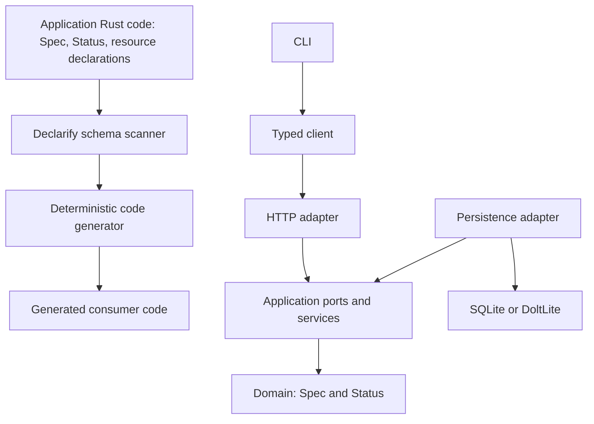

# Architecture

## Boundaries



The authoring source is application Rust code. The scanner/generator materializes
outer layers from it.

Runtime dependencies point inward: adapters depend on application contracts;
application code depends on domain types; domain types know nothing about HTTP,
CLI, or SQL.

## Cargo workspace

The initial repository should converge on this shape:

```text
crates/
  declarify-core/       resource protocol, shared errors, stable envelopes
  declarify-macros/     minimal resource declaration marker/macro surface
  declarify-schema/     constrained Rust source scanner + validated schema model
  declarify-codegen/    deterministic source generation
  declarify-cli/        declarify validate/generate/check
  declarify-runtime/    small reusable HTTP/SQL support only where justified
examples/
  notes/
docs/
testdata/
```

The `declarify-macros` crate must stay small. Its purpose is to make resource
declarations valid Rust and, where useful, provide compile-time diagnostics. It
must not hide generated application boundaries behind macro expansion.

## Consumer layout

A consuming application owns domain and composition code. Generated code is
organized by boundary:

```text
src/
  domain/
    note.rs             # handwritten NoteSpec / NoteStatus / resource declaration
  generated/
    resources/
    application/
    persistence/
    http/
    client/
    cli/
    mod.rs
  composition.rs        # handwritten dependency wiring
```

The whole `src/generated` tree is generator-owned. Handwritten code lives
outside it.

## Scanner boundary

`declarify-schema` is not a general Rust compiler front-end.

It scans the consumer crate's Rust sources for the explicit Declarify declaration
surface and resolves only the supported local `Spec`/`Status` shapes required by
Step 0.

Rules:

- scan source files under the selected Cargo package;
- ignore generator-owned output directories;
- parse Declarify resource declarations;
- locate referenced local structs/enums;
- validate only the supported type/Serde subset;
- fail clearly on ambiguous or unsupported constructs;
- never infer product semantics from method bodies or arbitrary Rust code.

DCL-0001 proves the smallest reliable scanner before generation expands.

## Runtime boundary

Generation should emit concrete code when that code expresses the consumer's
types or wiring. A small runtime crate may hold stable, type-independent
building blocks such as common error types, pagination envelopes, clocks, ID
interfaces, or shared HTTP helpers.

Do not move behavior into the runtime merely to reduce generated line count.
Generated ports, routes, repositories, and client methods must remain readable
at the consumer boundary.
